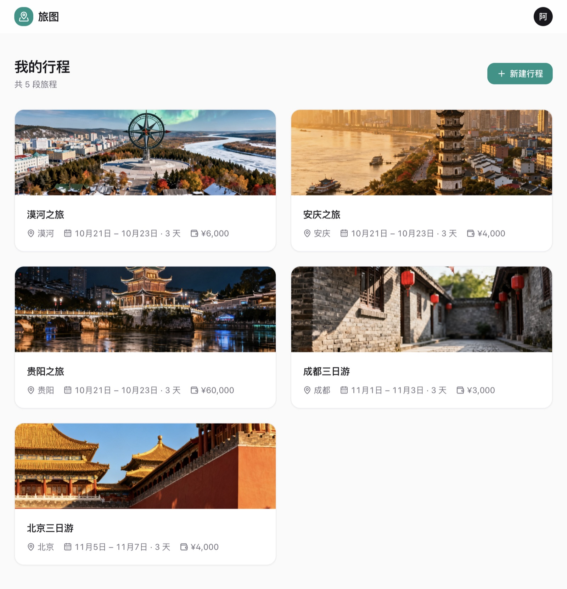
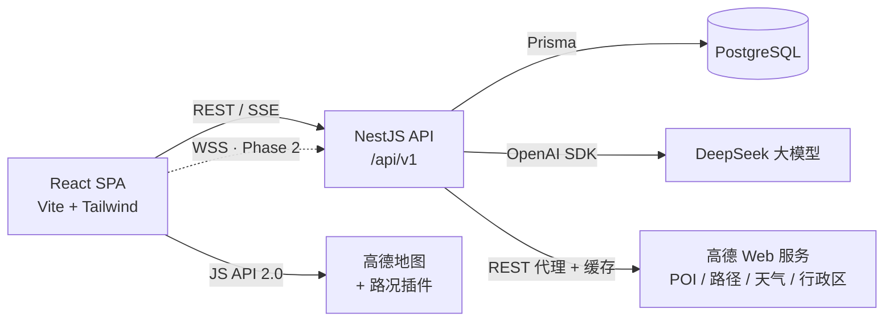

# 旅图 Lvtu

> 一句话说出目的地和偏好,AI 几秒生成一份带地图、天气和真实路况的完整旅行行程。


## 简介

旅图是一个 AI 驱动的旅行规划全栈应用。输入目的地、天数和偏好(比如"第一次去北京,想看历史古迹,吃地道小吃"),DeepSeek 大模型生成逐日行程;后端把地名逐个反查成高德真实坐标,再经**运筹学 TTDP 优化器**排出不折返的游览顺序,地图自动标注、按真实道路连线;生成的行程可以继续对话式调整("第二天加一个颐和园"),也可以手动拖拽精修。

设计上对标 Linear / Airbnb 的高级简洁:单主色 + 中性灰阶、毛玻璃顶栏、Spring 动效、完整的键盘可达性与焦点态。

## 功能特性

**Phase 1 · 已完成 ✅**

- 🔐 **账号体系** — 注册/登录,JWT access + refresh token 双令牌,httpOnly cookie 自动轮换续期(并发 401 共享同一次刷新,不误踢下线)
- 🤖 **AI 行程生成** — DeepSeek 结构化输出(JSON Schema + Zod 校验 + 自动修复容错链),SSE 流式进度;未配置 Key 时自动降级为 Mock 演示模式
- 💬 **对话式调整** — "第二天加个颐和园"这类自然语言指令,AI 整体重排行程并保留上下文
- 🧭 **TTDP 地理优化器** — 按运筹学旅游行程规划问题(Tourist Trip Design Problem)文献实现三段式:跨天离群点重分配(Cluster-first)→ 日内穷举精确排序 + U 型折返转向惩罚(Route-second)→ 按交通耗时重排时间轴;实测把"1→2 跑 100km、3 又回到 1 附近"的 zigzag 行程总里程砍到六成以下
- 📍 **坐标补全防错位** — 目的地 200km 半径过滤外省重名 + 天锚点就近选候选 + 泛名餐饮 60km 放弃;偏远目的地(如漠河)POI 覆盖率实测 7/20 → 15/20
- 🗺 **地图联动** — 真实道路路径(步行/驾车自动选择)虚线连线;悬停卡片 marker 高亮弹跳;**点击卡片地图平滑聚焦**;marker 带类型图标与序号
- 🌦 **天气因子** — 高德逐日天气预报(当天+未来 3 天):AI 排程时雨雪天优先室内;优化器再做**确定性双赢交换**(雨天的户外景点 ↔ 晴天的室内场馆);Day 标签与地图浮层显示天气
- 🚗 **实时路况** — 地图开关一键叠加:只沿行程路线渲染路况(绿/黄/红实色衬底),与规划虚线视觉区分
- ⭐ **POI 评分** — 高德 POI 详情自动补全评分与细分类目,时间轴卡片直接显示
- 🧩 **行程编辑器** — 天数 Tab + 时间轴卡片,dnd-kit 拖拽排序(乐观更新),POI 搜索一键添加,跨天移动
- 🛡 **优雅降级** — 三个外部 Key 任一缺失,对应能力降级而非报错(Mock 行程 / 手动输入 / 地图占位);封面图加载失败自动回退
- ✅ **全量测试** — 后端 90 例(AI/地理/行程/权限/优化器)+ 前端 21 例(封面/格式化/SSE 解析/图标),全部 vitest 全绿

**Roadmap**

- [ ] Phase 2 — 多人实时协作(Yjs CRDT)+ 在线光标 + 预算记账与分摊
- [ ] Phase 3 — 行程模板社区:发布、搜索、一键复用、点赞

## 更多截图

| 登录 | 行程列表 |
|---|---|
|  |  |

| AI 规划面板 | 悬停联动 |
|---|---|
|  |  |

## 技术栈

| 层 | 选型 |
|---|---|
| 前端 | React 18 · TypeScript · Vite · Tailwind CSS v4 · shadcn 风格组件(Radix)· Framer Motion · dnd-kit · TanStack Query · Zustand · Vitest |
| 后端 | NestJS 12(ESM)· Prisma 6 · PostgreSQL 15 · Passport JWT · Zod · Vitest |
| AI | DeepSeek(OpenAI 兼容协议,`json_object` 模式 + 结构化校验)|
| 地图 | 高德 JS API 2.0(前端,含 Driving 路况插件)+ 高德 Web 服务 API(后端代理:POI/路径/天气/行政区,防 Key 泄露)|
| 协作(Phase 2)| Yjs CRDT |

## 架构



设计要点:

- **AI 不编造坐标** — 大模型只输出地名,后端用高德 POI 逐个反查经纬度(并发限制 + 退避重试,规避个人 Key QPS 上限),三层防错位保证标不错
- **几何排序交给优化器,不交给 LLM** — 参照 ItiNera(EMNLP 2024)等研究:LLM 选点,TTDP 优化器排序,穷举精确解仅需毫秒
- **天气双保险** — 提示词软引导(雨雪室内)+ 算法硬兜底(错配双赢交换,几何增量超阈值不换)
- **单一写路径** — 行程编辑 REST 落库与(Phase 2 的)Yjs 协作文档不混写,避免冲突
- **降级优先** — 所有外部依赖缺失时应用仍可完整演示

## 项目结构

```
lvtu/
├── web/                        # 前端
│   └── src/
│       ├── components/ui/      # 设计系统组件(Button/Dialog/Toast…)
│       ├── features/
│       │   ├── auth/           # 登录 / 注册
│       │   ├── trips/          # 行程列表 + 城市封面
│       │   └── trip/           # 编辑器:时间轴 / 地图(天气·路况) / AI 面板
│       ├── lib/                # api 封装 / SSE 解析 / 高德加载
│       └── stores/             # Zustand(auth,刷新去重)
└── server/                     # 后端
    ├── prisma/schema.prisma    # 数据模型单一事实源
    └── src/
        ├── auth/               # 注册登录 + 双令牌
        ├── trip/               # 行程 CRUD + 权限守卫
        ├── ai/                 # DeepSeek 生成 + 容错链 + 坐标补全 + TTDP 优化器
        └── geo/                # 高德代理(POI/详情/路径/天气/行政区)+ 缓存
```

## 快速开始

**前置要求**:Node.js ≥ 20,PostgreSQL ≥ 15(本地安装或 Docker 均可)

```bash
git clone https://github.com/Gezhihao-nuist/lvtu.git
cd lvtu

# 1. 后端
cd server
npm install
cp .env.example .env        # 按需填写 Key(见下表)
npx prisma migrate dev      # 建表(DATABASE_URL 指向你的 Postgres)
npm run start:dev           # http://localhost:3000

# 2. 前端(新开终端)
cd web
npm install
cp .env.example .env        # 按需填写 Key
npm run dev                 # http://localhost:5173
```

打开 http://localhost:5173,注册账号即可使用。

### 环境变量

| Key | 位置 | 获取 | 缺失时行为 |
|---|---|---|---|
| `DEEPSEEK_API_KEY` | `server/.env` | [platform.deepseek.com](https://platform.deepseek.com) → API keys | AI 走内置 Mock 演示行程 |
| `AMAP_KEY` | `server/.env` | [lbs.amap.com](https://lbs.amap.com) 控制台,平台选「**Web服务**」(POI/路径/天气/行政区共用) | POI 搜索 503,可手动输入 |
| `VITE_AMAP_JS_KEY` + `VITE_AMAP_SECURITY_CODE` | `web/.env` | 同上,平台选「**Web端(JS API)**」,安全密钥同应用查看 | 地图区显示占位 |

> 修改 `.env` 后需重启对应服务;真实密钥请勿提交,`.gitignore` 已拦截。

### 测试

```bash
cd server && npx vitest run   # 后端 90 例
cd web && npm test            # 前端 21 例
```

## API 概览

前缀 `/api/v1`,除认证外均需 `Authorization: Bearer <token>`。

- **Auth** — `POST /auth/register` `POST /auth/login` `POST /auth/refresh` `POST /auth/logout` `GET /auth/me`
- **行程** — `GET/POST /trips` · `GET/PATCH/DELETE /trips/:id` · `POST /trips/:id/copy`
- **日程项** — `POST /days/:dayId/items` · `PATCH/DELETE /items/:id` · `POST /items/reorder`
- **AI(SSE)** — `POST /ai/trips/:id/generate` · `POST /ai/trips/:id/chat`
- **地理** — `GET /geo/poi?keyword=&city=` · `GET /geo/route?from=&to=&mode=` · `POST /geo/routes` · `GET /geo/weather?city=`

## License

[MIT](LICENSE) © 2026 Gezhihao-nuist
