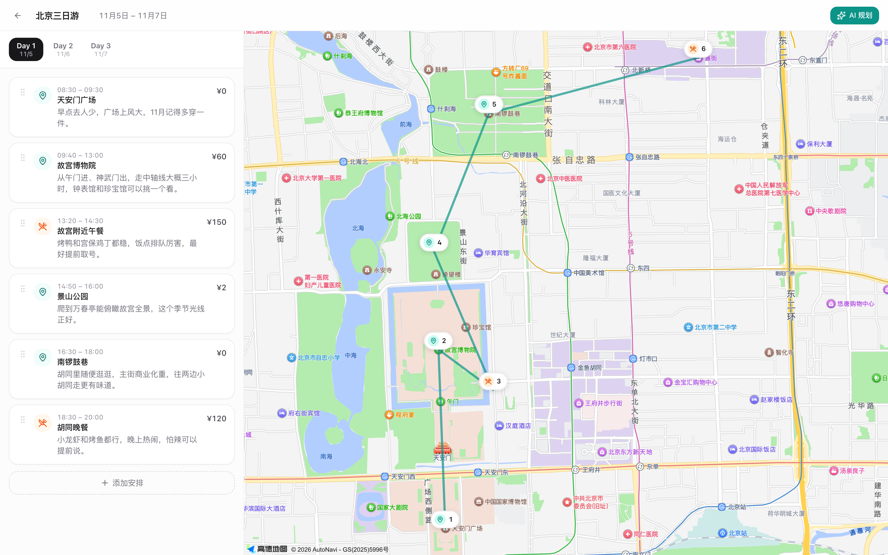
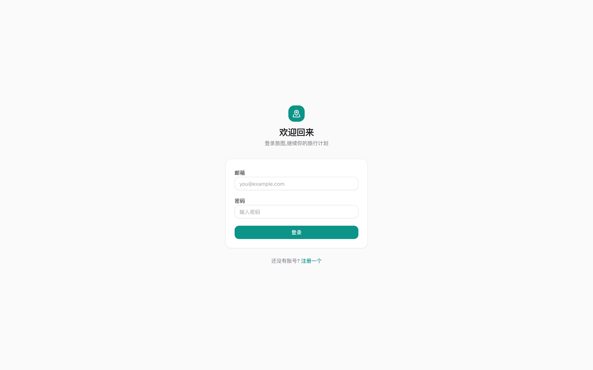
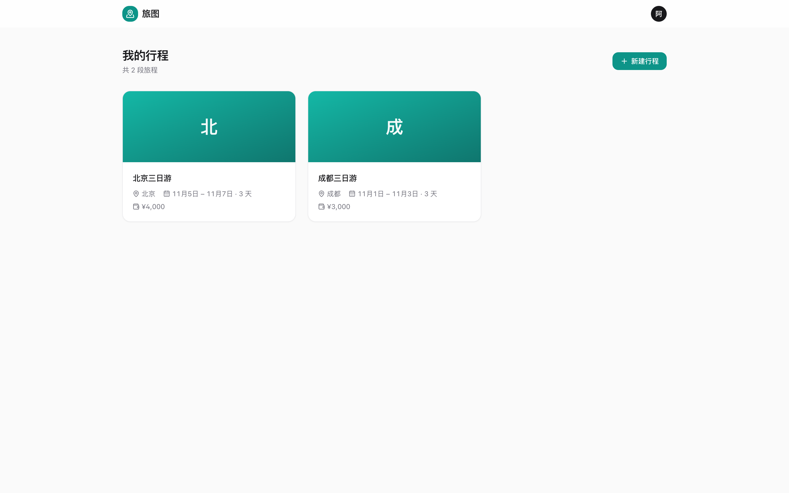
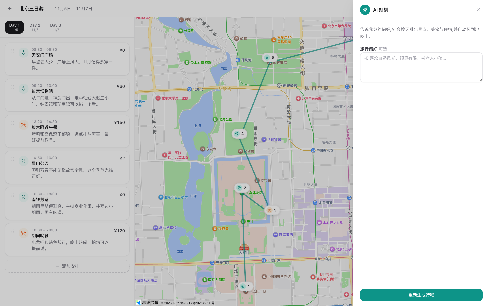
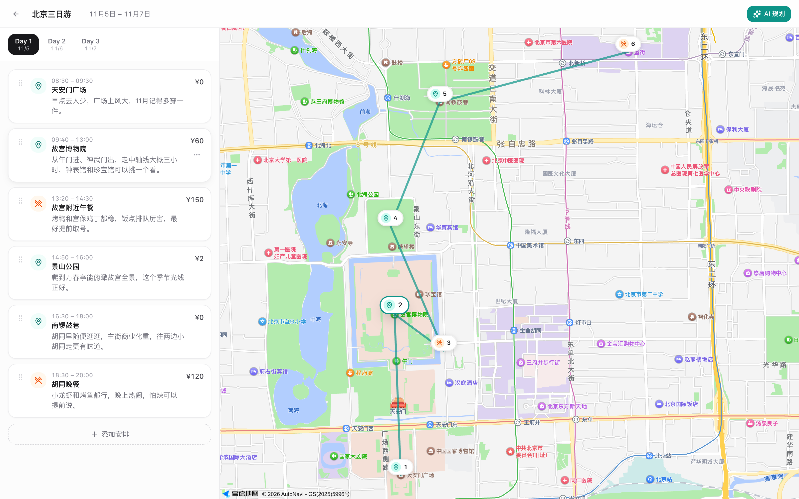
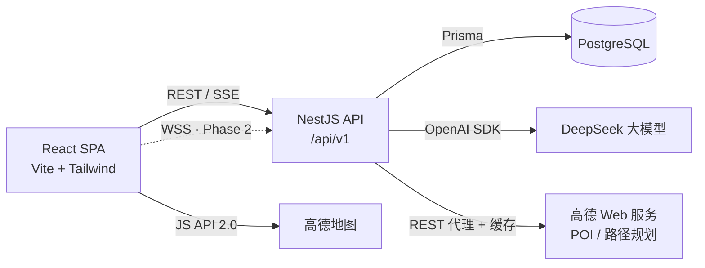

# 旅图 Lvtu

> 一句话说出目的地和偏好,AI 几秒生成一份带地图的完整旅行行程。




## 简介

旅图是一个 AI 驱动的旅行规划全栈应用。输入目的地、天数和偏好(比如"第一次去北京,想看历史古迹,吃地道小吃"),DeepSeek 大模型生成逐日行程,高德地图自动标注每个地点并连线;生成的行程可以继续对话式调整("第二天加一个颐和园"),也可以手动拖拽精修。

设计上对标 Linear / Airbnb 的高级简洁:单主色 + 中性灰阶、毛玻璃顶栏、Spring 动效、完整的键盘可达性与焦点态。

## 功能特性

**Phase 1 · 已完成 ✅**

- 🔐 **账号体系** — 注册/登录,JWT access + refresh token 双令牌,httpOnly cookie 自动轮换续期
- 🤖 **AI 行程生成** — DeepSeek 结构化输出(JSON Schema + Zod 校验 + 自动修复容错链),SSE 流式进度;未配置 Key 时自动降级为 Mock 演示模式
- 💬 **对话式调整** — "第二天加个颐和园"这类自然语言指令,AI 整体重排行程并保留上下文
- 🗺 **地图联动** — 高德地图自动标注当日全部行程点、按顺序连线;时间轴悬停卡片,对应 marker 实时高亮;AI 输出的地名自动反查高德 POI 补全坐标
- 🧩 **行程编辑器** — 天数 Tab + 时间轴卡片,dnd-kit 拖拽排序(乐观更新),POI 搜索一键添加,跨天移动
- 🛡 **优雅降级** — 三个外部 Key 任一缺失,对应能力降级而非报错(Mock 行程 / 手动输入 / 地图占位)

**Roadmap**

- [ ] Phase 2 — 多人实时协作(Yjs CRDT)+ 在线光标 + 预算记账与分摊
- [ ] Phase 3 — 行程模板社区:发布、搜索、一键复用、点赞

## 更多截图

| 登录 | 行程列表 |
|---|---|
|  |  |

| AI 规划面板 | 悬停联动 |
|---|---|
|  |  |

## 技术栈

| 层 | 选型 |
|---|---|
| 前端 | React 18 · TypeScript · Vite · Tailwind CSS v4 · shadcn 风格组件(Radix)· Framer Motion · dnd-kit · TanStack Query · Zustand |
| 后端 | NestJS 12(ESM)· Prisma 6 · PostgreSQL 15 · Passport JWT · Zod |
| AI | DeepSeek(OpenAI 兼容协议,`json_object` 模式 + 结构化校验)|
| 地图 | 高德 JS API 2.0(前端)+ 高德 Web 服务 API(后端代理,防 Key 泄露)|
| 协作(Phase 2)| Yjs CRDT |

## 架构



设计要点:

- **AI 不编造坐标** — 大模型只输出地名,后端用高德 POI 逐个反查经纬度(并发限制 + 重试,规避个人 Key QPS 上限),查不到标记待确认
- **单一写路径** — 行程编辑 REST 落库与(Phase 2 的)Yjs 协作文档不混写,避免冲突
- **降级优先** — 所有外部依赖缺失时应用仍可完整演示

## 项目结构

```
lvtu/
├── web/                        # 前端
│   └── src/
│       ├── components/ui/      # 设计系统组件(Button/Dialog/Toast…)
│       ├── features/
│       │   ├── auth/           # 登录 / 注册
│       │   ├── trips/          # 行程列表 + 新建
│       │   └── trip/           # 编辑器:时间轴 / 地图 / AI 面板
│       ├── lib/                # api 封装 / SSE 解析 / 高德加载
│       └── stores/             # Zustand(auth)
└── server/                     # 后端
    ├── prisma/schema.prisma    # 数据模型单一事实源
    └── src/
        ├── auth/               # 注册登录 + 双令牌
        ├── trip/               # 行程 CRUD + 权限守卫
        ├── ai/                 # DeepSeek 生成 + 容错链 + 坐标补全
        └── geo/                # 高德代理 + 缓存
```

## 快速开始

**前置要求**:Node.js ≥ 20,PostgreSQL ≥ 15(本地安装或 Docker 均可)

```bash
git clone https://github.com/Gezhihao-nuist/lvtu.git
cd lvtu

# 1. 后端
cd server
npm install
cp .env.example .env        # 按需填写 Key(见下表)
npx prisma migrate dev      # 建表(DATABASE_URL 指向你的 Postgres)
npm run start:dev           # http://localhost:3000

# 2. 前端(新开终端)
cd web
npm install
cp .env.example .env        # 按需填写 Key
npm run dev                 # http://localhost:5173
```

打开 http://localhost:5173,注册账号即可使用。

### 环境变量

| Key | 位置 | 获取 | 缺失时行为 |
|---|---|---|---|
| `DEEPSEEK_API_KEY` | `server/.env` | [platform.deepseek.com](https://platform.deepseek.com) → API keys | AI 走内置 Mock 演示行程 |
| `AMAP_KEY` | `server/.env` | [lbs.amap.com](https://lbs.amap.com) 控制台,平台选「**Web服务**」 | POI 搜索 503,可手动输入 |
| `VITE_AMAP_JS_KEY` + `VITE_AMAP_SECURITY_CODE` | `web/.env` | 同上,平台选「**Web端(JS API)**」,安全密钥同应用查看 | 地图区显示占位 |

> 修改 `.env` 后需重启对应服务;真实密钥请勿提交,`.gitignore` 已拦截。

## API 概览

前缀 `/api/v1`,除认证外均需 `Authorization: Bearer <token>`。

- **Auth** — `POST /auth/register` `POST /auth/login` `POST /auth/refresh` `POST /auth/logout` `GET /auth/me`
- **行程** — `GET/POST /trips` · `GET/PATCH/DELETE /trips/:id` · `POST /trips/:id/copy`
- **日程项** — `POST /days/:dayId/items` · `PATCH/DELETE /items/:id` · `POST /items/reorder`
- **AI(SSE)** — `POST /ai/trips/:id/generate` · `POST /ai/trips/:id/chat`
- **地理** — `GET /geo/poi?keyword=&city=` · `GET /geo/route?from=&to=&mode=`

## License

[MIT](LICENSE) © 2026 Gezhihao-nuist
